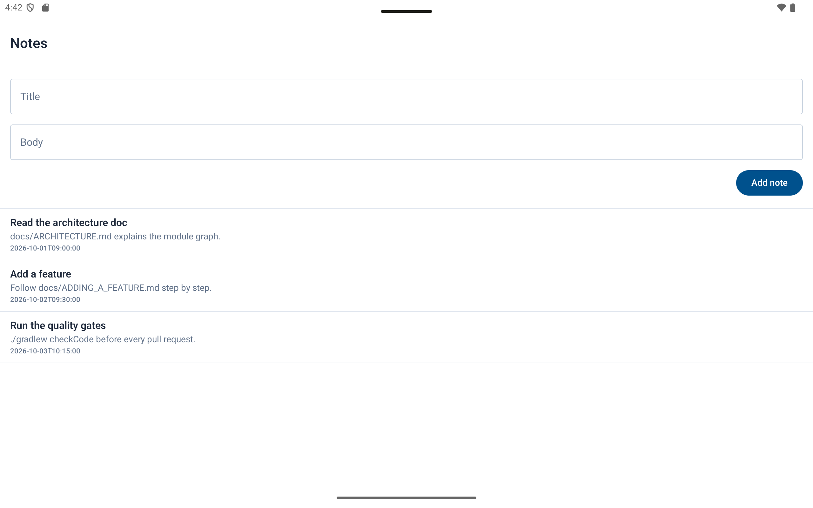
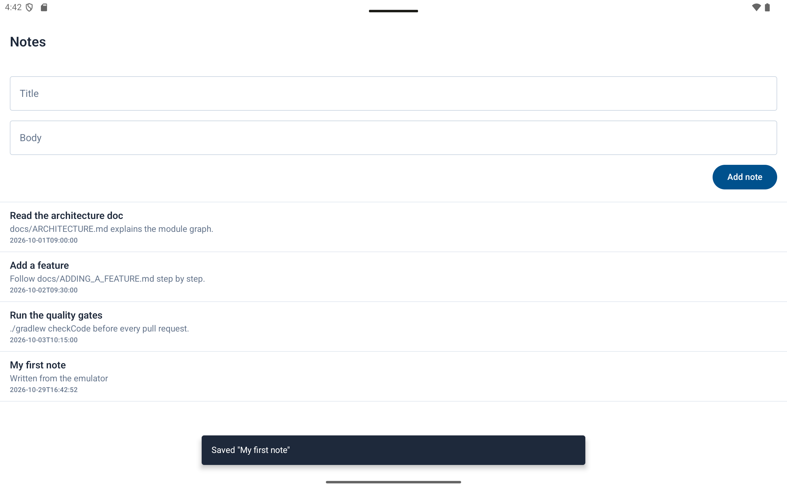
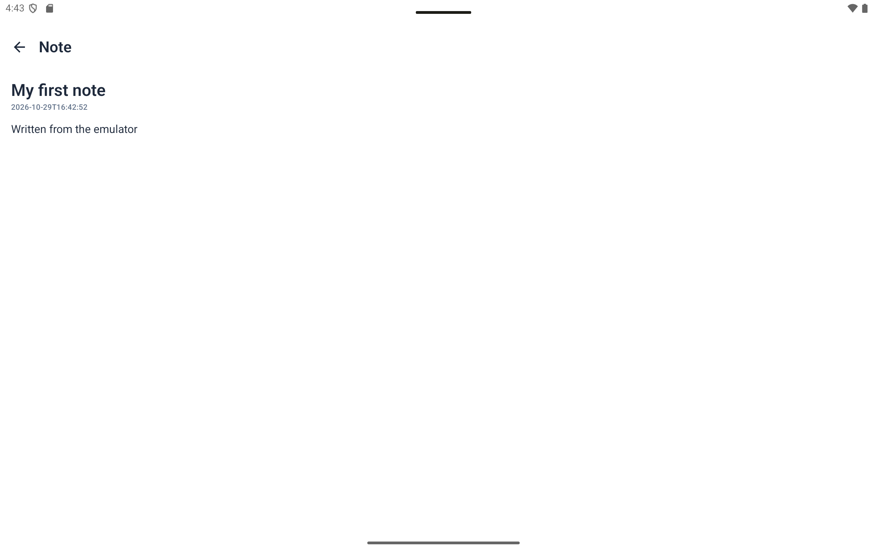
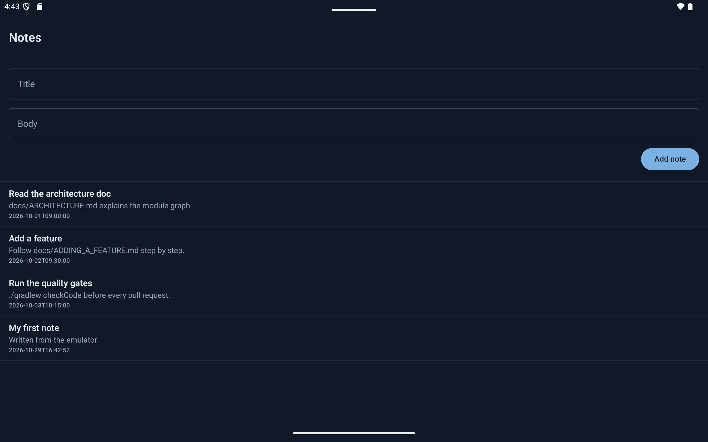

# KSHRD Android Starter

A small Kotlin / Jetpack Compose project that shows the **module structure and conventions used by
KSHRD Android apps**. It has one sample feature (notes) backed by an in-memory fake API, so it runs
with no server, no account, and no secrets.

Use it as the starting point for your own app: copy the project, rename the package, and add your
features by following the sample.

- Min SDK 26, Target SDK 36
- Kotlin 2.2, Jetpack Compose (Material 3), Hilt, Retrofit, Navigation Compose (typed routes)
- Clean Architecture + MVVM, multi-module

## Get started

1. Open the folder in Android Studio (Ladybug or newer). It will create `local.properties` with
   your SDK path. If it does not, copy `local.properties.example` and fill in `sdk.dir`.
2. Run the `app` configuration on an emulator or device.
3. Read, in this order:
   - [`docs/ARCHITECTURE.md`](docs/ARCHITECTURE.md): the module graph and the rules.
   - [`docs/presentation-conventions.md`](docs/presentation-conventions.md): the screen checklist.
   - [`docs/ADDING_A_FEATURE.md`](docs/ADDING_A_FEATURE.md): how to add your first feature.
   - [`AGENTS.md`](AGENTS.md): the same rules, condensed, for AI coding assistants.

## Commands

```bash
./gradlew assembleDebug        # build
./gradlew test                 # unit tests
./gradlew checkCode            # detekt, must pass before a pull request
./gradlew checkKtlint          # formatting report
./gradlew ktlintFormat         # fix formatting
```

## Layout

```
app/        MainActivity, StarterApplication, the navigation graph
features/   feature slices. Sample: note (list, add, detail)
core-ui/    theme, previews, motion, shared components
core/       DataState, RemoteDataSource, BaseResponse, typed destinations, network DI
docs/       architecture, conventions, feature walkthrough
```

## Where the sample lives

```
features/src/main/java/com/kshrd/features/note/
  data/api/NoteApi.kt             Retrofit interface
  data/api/InMemoryNoteApi.kt     fake backend (delete when you have a real one)
  data/service/NoteServiceImpl.kt
  data/repository/NoteRepositoryImpl.kt
  domain/model/Note.kt
  domain/repository/NoteRepository.kt
  domain/service/NoteService.kt
  domain/usecase/GetNotesUseCase.kt, GetNoteUseCase.kt, AddNoteUseCase.kt
  presentation/model/NoteListUiContract.kt     UiState + Event + Effect
  presentation/viewmodel/NoteListViewModel.kt, NoteDetailViewModel.kt
  presentation/components/NoteRow.kt, NoteComposer.kt, NoteListSkeleton.kt
  presentation/screen/NoteListScreen.kt, NoteDetailScreen.kt
```

## Connecting a real backend

1. Set `api.base.url` in `local.properties`.
2. In `features/di/FeatureApiModule.kt`, replace the in-memory binding with
   `retrofit.create(NoteApi::class.java)`.
3. Delete `InMemoryNoteApi.kt`. Nothing else changes.

## Screenshots

Taken on the Pixel Tablet emulator (API 35).

| List | Saved | Detail | Dark |
|---|---|---|---|
|  |  |  |  |
